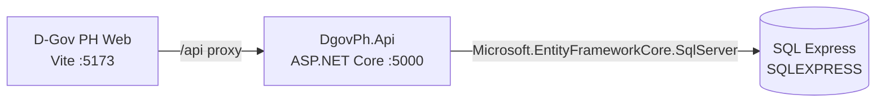

# Azure Debug Plan

> This plan is the source of truth for generating the
> VS Code debug setup in this workspace.
>
> **Status:** Implemented
> **Execution Mode:** Guided
> **Created:** 2026-11-09T18:05:58.4802591+08:00
> **Last Updated:** 2026-11-09T18:24:38.0155707+08:00
>
> <!-- Guided Mode (default) - hand-holds the user through review and approval before generating. -->

---

## Prerequisites

| Tool / Extension | Category | Service(s) | Installed | Version |
|------------------|----------|------------|-----------|---------|
| Node.js | Runtime | web | ✅ | 24.14.0 |
| npm | Package manager | web | ✅ | 11.11.0 |
| .NET SDK | Runtime / SDK | api | ✅ | 10.0.203 |
| EF Core .NET CLI | Migration tool | api | ✅ | 10.0.8 |
| Chrome | Browser | web | ✅ | 156.0.8078.80 |

---

## Debug Configurations

Each checked service produces a VS Code debug configuration. The compound configuration starts the API before the Vite frontend, whose `/api` proxy targets the API at `http://localhost:5000`.

| Generate | Debug Config Name | Service Label | Service Root | Project Type | Runtime | Version | Azure Dependencies |
|----------|--------------------|---------------|--------------|--------------|---------|---------|--------------------|
| [x] | DgovPh.Api (debug) | DgovPh.Api | ./services/api | app-service | dotnet | 10.0 | Azure SQL |
| [x] | D-Gov PH Web (debug) | D-Gov PH Web | ./services/web | frontend-spa | node-ts | 24.14.0 | — |
| [x] | Debug All Services | Debug All Services | — | *Compound Config* | — | — | — |

Project Type Descriptions

| Project Type | Description |
|-------------|-------------|
| app-service | ASP.NET Core HTTP API launched with the existing DgovPh.Api project profile. |
| frontend-spa | React and Vite single-page application, debugged in Chrome. |

> ℹ️ **Proxy detected:** `./services/web/vite.config.ts` proxies `/api` to `http://localhost:5000`; start the API before the frontend.

---

## Orchestrator

| Orchestrator | Container Runtime | Compose Command | Description |
|-------------|-------------------|----------------|-------------|
| Direct local services | Not used | — | Launch the API and frontend directly in VS Code; connect to the existing SQL Express instance. No container runtime is required. |

---

## Emulators

| Dependent Service | Emulator | Purpose |
|-------------------|----------|---------|
| Azure SQL | Existing SQL Server Express instance (`SQLEXPRESS`) | Local SQL Server-compatible database for EF Core schema and API development, using the existing Windows-authenticated connection. |

> The debug workflow uses SQL Express, which is currently running and selected by both Development appsettings and the EF design-time factory. The existing `docker-compose.yml` is left untouched but is not started or required by this plan.

---

## Architecture Diagram

During debugging, the React/Vite frontend sends `/api` requests through its development proxy to the ASP.NET Core API, which reads and writes the existing local SQL Express database.

---

## Migrations

When selected, the debug setup will run the existing EF Core migration against SQL Express before API startup. The migration creates the schema only; no seed data is added.

| Generate | Service | Migration Tool |
|----------|---------|----------------|
| [x] | DgovPh.Api | EF Core (`dotnet ef database update`) |

---

## API Test Collections

When selected, generate runnable smoke-test requests for the implemented API routes.

| Generate | Service | Description |
|----------|---------|-------------|
| [x] | DgovPh.Api | 

HTTP Endpoints (7)
 GET /api/health GET /api/dashboard GET /api/budget-records GET /api/budget-records/{id} GET /api/agencies GET /api/sources GET /api/catalog/datasets?q=&amp;page=&amp;pageSize=
 |

### GET /api/health `http-health`

### GET /api/dashboard `http-dashboard`

### GET /api/budget-records `http-budget-records`

### GET /api/budget-records/{id} `http-budget-record-by-id`

### GET /api/agencies `http-agencies`

### GET /api/sources `http-sources`

### GET /api/catalog/datasets `http-catalog-datasets`

---

## Convenience Scripts

No project-level convenience scripts are selected; VS Code tasks will own the local debug and database lifecycle so existing package scripts remain unchanged.

| Generate | Script | Registered In | Description |
|----------|--------|---------------|-------------|

## Debug Configuration Checklist

✅ DgovPh.Api (debug) — `Now listening on: http://localhost:5000`; `GET /api/health` returned HTTP 200; `DgovPh.Api.exe` matched.
✅ D-Gov PH Web (debug) — Vite `Local:` ready on port 5173; `GET /` returned HTTP 200.
✅ Debug All Services — API started before Vite; each service started once and returned HTTP 200.
